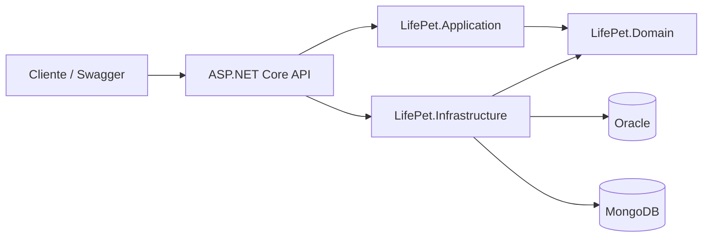

# LifePet API

API REST para organizar os cuidados e o acompanhamento da saúde de animais de estimação. O sistema reúne tutores, pets, vacinas, consultas, medicamentos, histórico clínico e notas clínicas.

Projeto acadêmico da disciplina **Advanced Business Development with .NET** (FIAP).

## Integrantes

- Aguinel Junior Bento da Silva — RM564857
- Felipe da Silva — RM563485
- Henrique Gonçalves — RM562086
- Leonardo Saavedra — RM562228
- Vitor Mendes — RM565376

## Arquitetura

A solução segue Clean Architecture, separando responsabilidades entre API, Aplicação, Domínio e Infraestrutura:



- **API:** controllers, autenticação, Swagger, tratamento global de exceções e links HATEOAS.
- **Aplicação:** serviços, DTOs e abstrações dos recursos.
- **Domínio:** entidades, regras de negócio e contratos de repositório.
- **Infraestrutura:** persistência Oracle com Entity Framework Core, repositórios MongoDB, JWT e health checks.

## Tecnologias

- .NET 10 e ASP.NET Core Web API
- Entity Framework Core com Oracle
- MongoDB para notas clínicas
- Swagger/OpenAPI
- JWT Bearer
- Serilog e OpenTelemetry
- xUnit

## Pré-requisitos

- .NET SDK 10
- Instância Oracle acessível e MongoDB acessível
- SQL Developer ou ferramenta equivalente para administrar o Oracle (opcional)

## Configuração

Defina as configurações nos arquivos `appsettings.json` e `appsettings.Development.json`, ou use variáveis de ambiente. Não versione senhas ou chaves reais.

```json
{
  "ConnectionStrings": {
    "OracleConnection": "User Id=<usuario>;Password=<senha>;Data Source=<host>:1521/<servico>"
  },
  "Mongo": {
    "ConnectionString": "mongodb://localhost:27017",
    "Database": "lifepet",
    "NotasCollection": "notas_clinicas"
  },
  "Jwt": {
    "Key": "<chave-secreta-com-no-minimo-32-caracteres>",
    "Issuer": "LifePetApi",
    "Audience": "LifePetApi",
    "ExpirationMinutes": 60
  },
  "Auth": {
    "Users": [
      {
        "Username": "<usuario>",
        "Password": "<senha>",
        "Role": "Admin"
      }
    ]
  }
}
```

Configure também o usuário de autenticação na seção `Auth:Users` ou pelo mecanismo de configuração do ambiente. Em produção, use segredos seguros fora dos arquivos versionados.

## Executar a API

Na raiz do repositório:

```bash
dotnet restore
dotnet ef database update
dotnet run
```

A URL local depende de `Properties/launchSettings.json`. No perfil padrão, a interface Swagger fica em `http://localhost:5219/swagger`.

## Autenticação

As rotas de login não exigem token:

```http
POST /api/auth/login
Content-Type: application/json

{
  "username": "<usuario>",
  "password": "<senha>"
}
```

Envie o token retornado nas rotas protegidas usando `Authorization: Bearer <token>`. O Swagger também permite configurar o token pelo botão **Authorize**.

## Endpoints

Consulte o Swagger para os schemas, parâmetros e códigos de resposta detalhados. As rotas de listagem aceitam paginação e, conforme o recurso, ordenação e busca; as respostas paginadas incluem links HATEOAS.

| Recurso | Base | Rotas específicas |
|---|---|---|
| Autenticação | `/api/auth` | `POST /login` |
| Tutores | `/api/tutores` | `GET /{id}`, `GET /email/{email}`, `GET /{tutorId}/pets` |
| Pets | `/api/pets` | `GET /{id}`, `GET /especie/{especie}`, `GET /tutor/{tutorId}` |
| Vacinas | `/api/vacinas` | `GET /{id}`, `GET /pet/{petId}`, `GET /atrasadas` |
| Consultas | `/api/consultas` | `GET /{id}`, `GET /pet/{petId}`, `GET /futuras` |
| Medicamentos | `/api/medicamentos` | `GET /{id}`, `GET /pet/{petId}`, `GET /ativos` |
| Histórico clínico | `/api/historicos` | `GET /{id}`, `GET /pet/{petId}`, `GET /tipo/{tipo}` |
| Notas clínicas | `/api/notas-clinicas` | `GET /{id}` |

Os recursos tutores, pets, vacinas, consultas, medicamentos, históricos e notas clínicas possuem operações de criação, consulta, atualização e remoção, conforme documentado no Swagger.

Parâmetros de consulta comuns: `page`, `pageSize`, `sortBy`, `sortDirection` e `search`. O tamanho de página é limitado pela aplicação.

## Persistência

- **Oracle:** dados relacionais acessados com Entity Framework Core. Para aplicar as migrations:

  ```bash
  dotnet ef database update
  ```

- **MongoDB:** documentos de notas clínicas. Configure conexão, banco e coleção na seção `Mongo`.

## Monitoramento e observabilidade

- `GET /health`: verifica a saúde da aplicação.
- `GET /health/ready`: verifica a disponibilidade das dependências Oracle e MongoDB.
- Logs estruturados de requisição são gravados no console via Serilog.
- OpenTelemetry coleta traces e métricas de ASP.NET Core, chamadas HTTP e runtime, com exportação para o console.
- Erros não tratados são tratados pelo middleware global de exceções e retornados no formato Problem Details.

## Testes

Execute os testes automatizados da solução:

```bash
dotnet test
```

Os projetos de teste usam xUnit. Há testes unitários para domínio e aplicação e testes de integração HTTP para health check, Swagger e proteção JWT.

Para gerar relatório de cobertura:

```bash
dotnet test --collect:"XPlat Code Coverage"
```

## Estrutura do repositório

```text
Controllers/                 Endpoints REST
Hateoas/                     Links e respostas HATEOAS
LifePetApi.csproj            Aplicação ASP.NET Core
LifePet.Application/         Serviços, DTOs e abstrações
LifePet.Domain/              Entidades, regras e repositórios
LifePet.Infrastructure/      Oracle, MongoDB, JWT e health checks
LifePet.Api.Tests/           Testes de integração HTTP
LifePet.Application.Tests/   Testes da aplicação
LifePet.Domain.Tests/        Testes do domínio
Migrations/                  Migrations do Entity Framework Core
Scripts/                     Scripts SQL auxiliares
```
